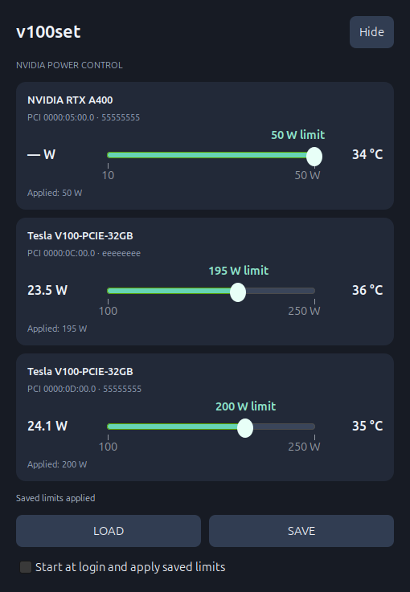

# v100set

A small Linux tray app for live NVIDIA GPU power limits. Built for Tesla V100 workstations; discovers all NVIDIA GPUs supported by `nvidia-smi`.

Each GPU has a card with **live power draw on the left**, a **power-limit slider in the middle**, and **temperature on the right**. Limits are shown in watts, within the range reported by the driver. Missing sensor readings show a dash; unsupported power controls are disabled.



*Preview uses simulated telemetry.*

## Install (Ubuntu 24.04 / Debian-family desktops)

Requires an installed NVIDIA driver, a graphical desktop and a tray/AppIndicator host. Ubuntu's default GNOME desktop includes the AppIndicator extension; other GNOME installations may need to enable it. The control panel remains available from the applications menu even without a tray host.

```bash
git clone https://github.com/GizmoR13/v100set.git
cd v100set
sudo bash install.sh "$USER"
v100set
```

The installer adds GTK 3 and Ayatana AppIndicator bindings when missing. It does not install CUDA, PyTorch or a driver. This desktop utility uses distribution Python/GTK packages, without modifying AI environments.

## Use

- Open the tray icon → **Power controls**. On supported desktops, middle-click opens the panel directly. AppIndicator hosts own the tray menu, so opening it is not a custom slider popup inside the system volume menu.
- Drag a slider to change the limit live. Changes are debounced by 400 ms and verified against the driver. GPU identity uses UUID, never a possibly changing index.
- **SAVE** stores the selected limits in `~/.config/v100set/settings.json`.
- **LOAD** reads those values and applies them to matching GPUs. Missing devices and invalid saved limits are reported rather than assigned to a different card.
- **Start at login and apply saved limits** installs an XDG desktop autostart entry. When enabled, the app starts hidden in the tray and restores saved limits after graphical login, retrying initial GPU discovery briefly.
- Unchecking autostart removes that entry. v100set will neither launch nor apply limits at the next login. It does **not** reset limits currently applied, or disable settings from unrelated software.
- Closing or hiding the window keeps the tray app running. **Quit v100set** exits; already applied limits remain managed by the driver.

SAVE does not turn on autostart. Enabling autostart does not silently overwrite your saved profile: press SAVE to choose the limits to restore. Launching the app manually only reads telemetry until you move a slider or press LOAD. This is **login autostart**, not a boot-time system service. Logging in is required for automatic restore.

Power limits are ceilings, not fixed power consumption. Lower limits can reduce performance. The app does not control cooling, clocks, voltage or persistence mode. Driver acceptance does not replace adequate cooling and power delivery.

## Permissions

The GUI runs as your normal user. A small root-owned helper at `/usr/local/libexec/v100set-power` is the only sudo-authorized command. A per-user sudoers rule permits that helper without a password so live adjustments and login restore work without prompts.

The helper uses isolated system Python, a fixed `nvidia-smi` path and a clean environment. It validates exactly two arguments, verifies the UUID and the GPU's current minimum/maximum limits, sets only its power limit and reads it back. It accepts no command paths, configuration files, shell snippets or other NVIDIA operations. This grants the selected local user permission to change supported NVIDIA power limits; it is not a general sudo grant. Keep the helper and its parent directories root-owned.

Only GPUs discovered by the NVIDIA driver are shown; AMD/Intel power control is not implemented. A card can advertise a range yet reject a change due to device/driver restrictions; the app reports that error.

## Existing power-limit services

If you previously created a service named `v100-power-limit.service`, it would continue applying its own boot limits independently. To explicitly disable that service during installation, preserving its files and current GPU limits:

```bash
sudo bash install.sh "$USER" --replace-v100-service
```

Other power-control tools are not modified. To restore the old service later, use `sudo systemctl enable v100-power-limit.service`.

## Development and tests

```bash
python3 -m unittest discover -s tests -v
python3 tests/gui_smoke.py
python3 run.py
```

The tests use simulated GPU responses and temporary settings directories; they never change hardware limits. The GUI smoke test requires a graphical session and checks three cards, slider debouncing, LOAD/SAVE, the autostart toggle and hidden startup restoration. Real hardware acceptance should include telemetry and a small reversible limit change.

Runtime: Python 3.10+, PyGObject, GTK 3, Ayatana AppIndicator, `sudo`, `nvidia-smi`. Tested on Ubuntu 24.04 with X11; other desktop/tray hosts may present activation differently.

## Uninstall

Quit the app, uncheck autostart, then run `sudo bash uninstall.sh`. Settings are retained. Uninstallation does not reset the GPUs or automatically restore previous boot services.

## License

MIT. See [LICENSE](LICENSE).
